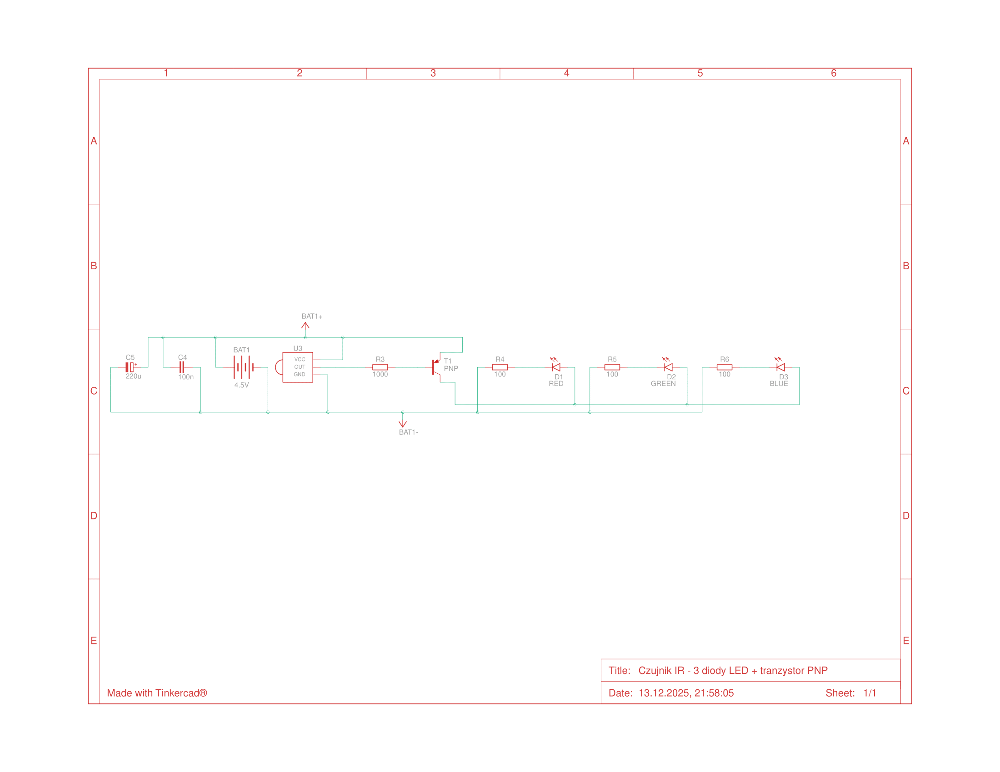
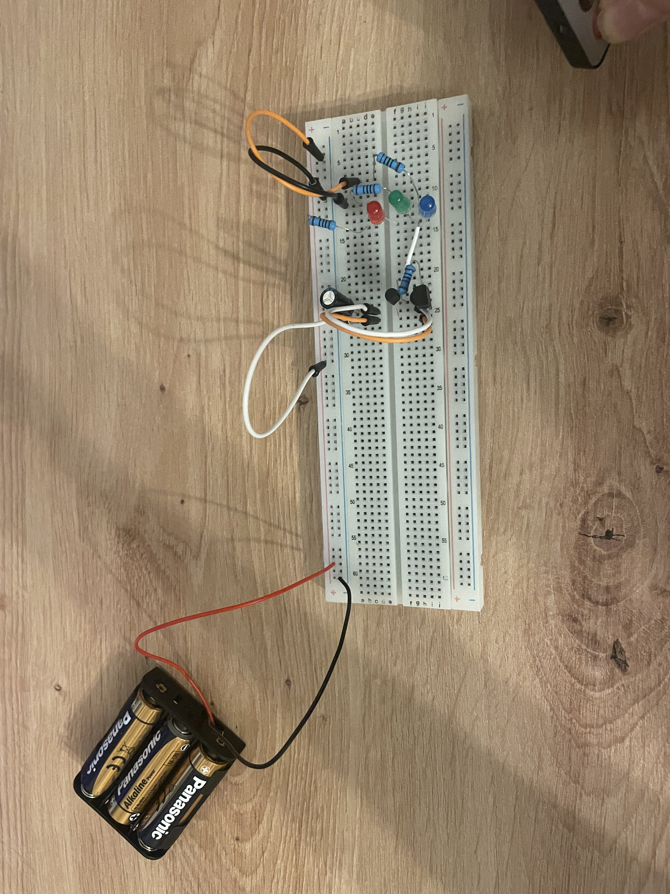

# 🚀 Odbiornik podczerwieni + 3 diody LED + tranzystor PNP

## 🌟 Opis Projektu

Ten projekt prezentuje budowę i działanie układu do zdalnego sterowania oświetleniem LED, wykorzystującego sygnały podczerwone (IR). Głównym celem projektu jest demonstracja:

1.  **Integracji Czujnika IR (TSOP34838):** Układ odbiera sygnał z dowolnego pilota IR i przetwarza go na sygnał sterujący.
2.  **Zastosowanie Tranzystora PNP (S8550) jako wzmacniacz, który kontroluje przepływ prądu do diod LED. Tranzystor wzmacnia słaby prąd z wyjścia TSOP do poziomu wymaganego przez diody LED.

---

## 📋 Użyte Komponenty (Bill of Materials – BOM)

| Komponent | Symbol | Wartość/Typ | Funkcja | Ilość |
| :--- | :--- | :--- | :--- | :--- |
| Tranzystor PNP | T1 | **S8550** | Wzmacniacz prądu | 1 |
| Odbiornik IR | U1 | **TSOP34838** | Odbiór sygnału z pilota IR (wyjście LOW-Active) | 1 |
| Dioda LED | D1, D2, D3 | **Czerwona, Zielona, Niebieska** | Obciążenie / Wskaźniki świetlne | 3 |
| Rezystory LED | R4, R5, R6 | **100 $\Omega$** | Ograniczenie prądu dla każdej diody LED (połączenie równoległe) | 3 |
| Rezystor Bazy | R\_base | **1 k$\Omega$** | Bezpieczne ograniczenie prądu $I_B$ | 1 |
| Kondensator Filtracji | C1 | **220 $\mu\text{F}$** | Filtracja tętnień zasilania (elektrolityczny) | 1 |
| Kondensator Odprzęgający| C2 | **100 $\text{nF}$** | Odprzęganie szumów (ceramiczny) | 1 |
| Zasilanie | BAT1 | **4.5 V** (3x AA) | Źródło zasilania układu | 1 |

---

## 📐 Schemat Ideowy

Poniżej znajduje się schemat ideowy, który przedstawia konfigurację połączeń w układzie.

---

## 📸 Galeria Zdjęć

### Zdjęcie  Układu

## 📺 Demonstracja Działania (Video)

Poniższy link prowadzi do pełnej demonstracji wideo, która przedstawia włączanie i wyłączanie diod LED za pomocą pilota IR, pokazując udaną integrację TSOP i tranzystora.

**Link do Wideo:** [Obejrzyj działanie układu na YouTube](https://www.youtube.com/shorts/gkjFJrYc7yM)
